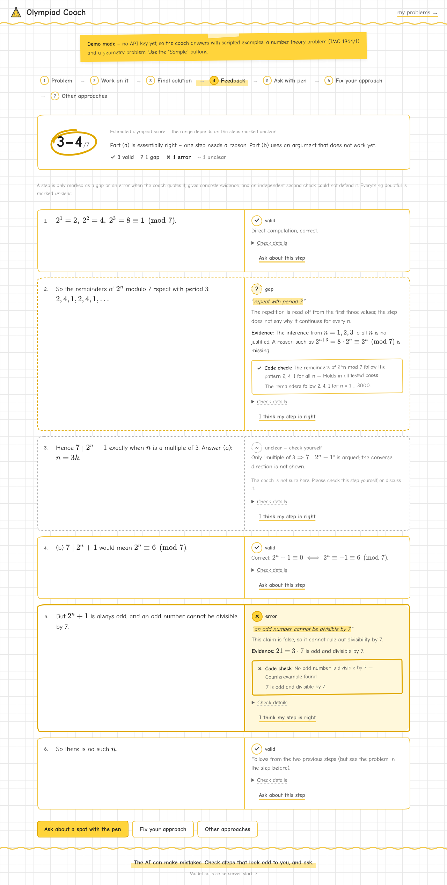
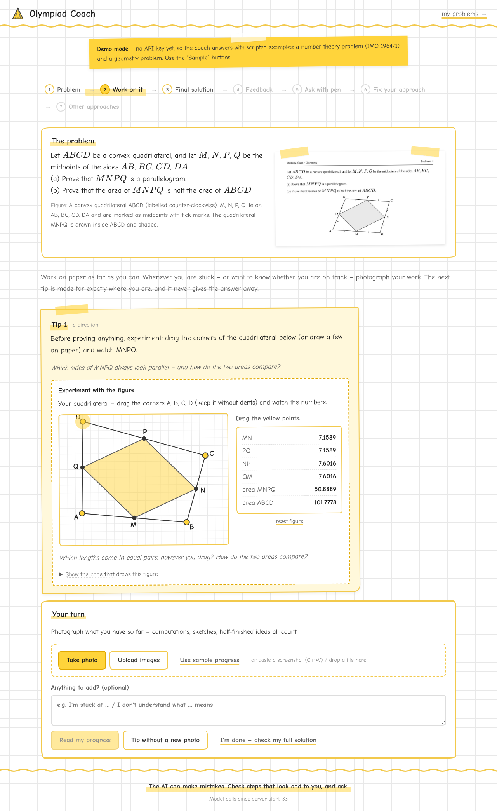

# Olympiad Coach

A web app that coaches students through math olympiad problems **without giving the solution away**. You photograph a problem and work on it on paper. Whenever you are stuck, you photograph your progress and get one tip made for exactly where you are. At the end you photograph your solution and get step-by-step feedback that has been **checked twice and, where possible, tested by code** before you see it.

Built for the Meta Global AI Developer Hackathon (submission deadline 4 Nov 2026, 21:00 ET) on the Meta Model API (Muse Spark, optionally Muse Wonder for verification).



The interface is a math notebook: white squared paper, handwriting (Comic Sans, with the bundled Comic Neue as a fallback), gray ink and yellow accents. Verdicts are teacher's marks in the margin (✓ valid, ? gap, ✗ error, ~ unclear), code checks look like stamps, and the score is circled like a grade.

## Principles

- **Paper, not keyboard.** Problems and solutions come in as photos/screenshots; thinking happens with a pen.
- **Tips for where you are, not solutions.** One tip at a time, based on a photo of your own progress, and more concrete only when you stay stuck.
- **Claims are checked by code**, not only by the model (brute force, counterexample search, random tests), in a sandboxed Web Worker.
- **You confirm what was read** (problem text and solution steps) before anything is judged.
- **No gaslighting.** A step is only called a gap or an error when the critique quotes it, gives concrete evidence, and an independent second call could not defend it. Everything doubtful is shown as *unclear*.
- **Every valid way is a good way.** The coach repairs *your* approach instead of replacing it. At the end it shows other approaches to learn from, not "the right one".

## The screens

| # | Screen | What happens |
|---|--------|--------------|
| 1 | **Problem** | Photo, screenshot (paste with Ctrl+V) or file. The model transcribes it; you confirm or fix it ("Did I read this correctly?"). |
| 2 | **Work on it** | The tip loop: one tip to start, then work on paper and photograph your progress (or just write where you are stuck). You confirm what was read, and the next tip builds on exactly your work. It acknowledges what you have, nudges the next step, and gets more concrete only if you make no progress (direction → concrete idea → key insight, never the solution). A tip can attach a tool when it helps: the problem in simple words, given/wanted, small cases computed by code (an interactive figure for geometry), a method, or a proof skeleton. If a claim in your work is testable, a code check runs on it. When your work looks complete, you can send it straight to the full check. |
| 3 | **Final solution** | Photograph your handwritten pages; the recognized steps are shown next to the photo and you fix reading errors. |
| 4 | **Feedback** | Every step: *valid* / *gap* / *error* / *unclear*, with reason, quote, evidence, code-check result, score estimate 0–7 (as a range when steps are unclear). Disagree with any verdict and discuss it as equals. |
| 5 | **Ask with pen** | Circle a spot on your solution image; the crop (bounding box + margin), the full page and your question go to the coach. Every marking has its own chat. |
| 6 | **Fix your approach** | One card per approach: does it carry (yes/partly/no), where exactly it breaks, and the minimal repair as hints (direction first, then detail). |
| 7 | **Other approaches** | 2–4 one-line ideas with the principle behind each. Opening one develops a full solution, which is independently verified and tested by code first. Ask about any step (with the pen or a button), challenge a step ("That's not right?"), or write your own version with the idea and have it graded. |

A permanent footer reminds you: *The AI can make mistakes. Check steps that look odd to you, and ask.*

## Geometry

Geometry gets the same coaching, with figures instead of number tables:

- **Reading the problem:** the transcription also describes the figure in words (points, lines, marked lengths and angles). You confirm that description like the text, and the original image stays next to the problem.
- **Small cases become an experiment:** when a tip attaches small cases, a geometry problem gets an interactive figure on squared paper instead of a table. The model writes construction code from draggable points, which re-runs in the sandbox on every drag. Live measurements (lengths, angles, areas) let you see what stays the same.
- **Claims are tested on random shapes:** checks use a small geometry library (`geo`: midpoints, intersections, feet of perpendiculars, circumcenter, areas, `collinear`/`concyclic` tests, random triangles and convex quadrilaterals, …). For example, "the area of MNPQ is MN · NP" is refuted with a concrete quadrilateral, out of 2000 random ones tested.
- **Alternative solutions** for geometry come with their own figure showing the construction they use.

The helpers live in [`shared/geo.ts`](shared/geo.ts), and the figure format is documented next to `interpretFigure` in [`shared/codecheck.ts`](shared/codecheck.ts).



## How verification works

```
Critique of your solution                     Alternative solutions (only on click)
──────────────────────────                    ─────────────────────────────────────
evaluate (first pass)                         propose ideas (no computation)
   │ gap/error must quote the step                │
   ▼                                              ▼ per idea, when opened
refute (fresh call, verifier model):          solve (complete numbered steps + justifications)
 "try to show this step is fine"                  │
   │                                              ▼
   ▼                                          verify (fresh call, verifier model) ──flawed──► repair once
code check in Web Worker                          │
 (counterexample / recomputation)                 ▼
   │                                          code checks in Web Worker
   ▼                                              │
merge → valid | gap | error | unclear             ▼
   │                                          consistency: results of all surviving approaches must agree
   ▼                                              │
discussion can change it                          ▼
 (coach concedes or leaves an open point)     verified → shown · no testable claim → "only logically checked"
                                              inconsistent/uncertain → "not verified" · contradicted → not shown
```

The merge rules live in [`shared/verdict.ts`](shared/verdict.ts) and [`shared/alternatives.ts`](shared/alternatives.ts) and are unit-tested.

- A critique without a verbatim quote, without an upheld refutation, or contradicted by code becomes **unclear**.
- A "valid" step whose claim fails a code test also becomes unclear.
- Deductions of withdrawn critiques are given back, and unclear ones widen the score range.

**Sandbox:** model-written JavaScript runs in a fresh Web Worker per check, with a 3-second limit.

- Network, storage and nested-worker APIs are removed along the whole prototype chain.
- The server sends a `Content-Security-Policy` for the worker script (`default-src 'none'; script-src 'self' 'unsafe-eval'`), so it cannot open connections or load external code.
- An end-to-end test asserts this.

## Quick start

Requirements: Node.js ≥ 20.19.

```sh
npm install
npm run dev          # http://localhost:8787
```

Without an API key the app runs in **demo mode**: a scripted coach that exercises every path, so the whole app can be tried and tested offline. There are two scripted problems:

- **Number theory:** IMO 1964 Problem 1.
- **Geometry:** the midpoint quadrilateral, with its area.

Use the "Sample: …" buttons to load the sample photos. The demo cannot read images, so for your own photos it picks a script by image shape: wide screenshots get number theory, everything else gets geometry.

The number theory demo shows:

- a confirmed gap;
- a critique that the independent check rejects (shown as *unclear*; the coach concedes in discussion);
- an error confirmed by a computed counterexample;
- a verified alternative;
- a logic-only alternative;
- an alternative that code catches and hides.

The geometry demo shows the interactive figure, two false area formulas refuted on random quadrilaterals, a withdrawn critique, and a vector solution with its own figure.

### Using the Meta Model API

```sh
cp .env.example .env
# set MODEL_API_KEY=… (and the model IDs once confirmed on dev.meta.ai)
npm run smoke:api    # checks every call returns valid JSON, using the sample images
npm run dev
```

The key is only read by the local server and never reaches the browser.

| Variable | Default | Purpose |
|----------|---------|---------|
| `MODEL_PROVIDER` | `auto` | `auto` (Meta API if a key is set, else demo), `meta`, `mock` |
| `MODEL_API_KEY` | – | Meta Model API key |
| `MODEL_BASE_URL` | `https://api.meta.ai/v1` | OpenAI-compatible endpoint |
| `MODEL_FAST` | `muse-spark-1.3` | transcription, hints, recognition, evaluation, chat |
| `MODEL_STRONG` | = `MODEL_FAST` | default for verification calls (set to Muse Wonder) |
| `MODEL_VERIFIER` / `MODEL_SOLVER` | `MODEL_STRONG` / `MODEL_FAST` | fine-grained overrides |
| `MODEL_JSON_MODE` | `true` | send `response_format: json_object` (set `false` if rejected) |
| `MODEL_TIMEOUT_MS` | `120000` | per-request timeout |
| `MOCK_LATENCY_MS` | `500` | simulated latency in demo mode |
| `PORT` | `8787` | server port |

**Model IDs are placeholders.** `muse-spark-1.3` / `muse-wonder-1.0` are assumptions; check the real IDs on dev.meta.ai and set them in `.env`.

### Testing handwriting recognition

Put 3–5 photos of real handwritten solutions into `handwriting-samples/`. Optionally add a `<name>.txt` next to each photo with what is actually written. Then run:

```sh
npm run handwriting-test
```

This writes `handwriting-report/report.md`, with the recognized steps next to each photo and a similarity score where a `.txt` exists.

## Production build

```sh
npm run build
npm start            # serves dist/ and the API on PORT
```

## Tests

```sh
npm test             # vitest: verdict/alternative logic, JSON handling, pipelines,
                     # Meta API client against a fake OpenAI-compatible server
npm run test:e2e     # Playwright: full flow in demo mode (real browser, worker, IndexedDB),
                     # geometry flow with dragging, mobile layout, sandbox isolation;
                     # writes docs/screenshots/
npm run typecheck
```

## Architecture

```
shared/        contracts used by both sides
  schemas.ts       zod schemas for every model output (validated on the server)
  api.ts           request/response types
  verdict.ts       critique + refutation + code check → final verdict, score range
  alternatives.ts  verification + checks + consistency → show / mark / hide
  codecheck.ts     executing and interpreting model-written checks and figures
  geo.ts           geometry helpers available to all sandboxed code
server/        Express + TypeScript (tsx), Vite middleware in dev
  prompts/         one prompt builder per task, strict JSON formats
  coach.ts         pipelines: evaluate→refute, solve→verify→repair, …
  llm/             OpenAI-compatible Meta provider, JSON extraction + one repair round,
                   scripted demo provider with one script per problem (llm/mock/scripts)
src/           React 19 client
  features/        one folder per screen
  components/      MathText (KaTeX), GeoFigure, PenCanvas, MarkableSteps, ChatThread, ImageInput, …
  workers/         sandbox.worker.ts
  lib/storage.ts   IndexedDB behind a SessionStore interface (swap in Firestore later)
```

The data model ([`src/session/types.ts`](src/session/types.ts)) follows the spec. Each locally stored `Session` holds:

- the `Problem`;
- the `Hints`;
- the `Attempt`, with its `Annotation`s;
- the `Correction`;
- the `Alternative`s, including their question threads, challenges and the own-version attempt.

Cost control:

- Hints, corrections and alternatives are only generated on click.
- Alternatives are developed one at a time when opened.
- The footer shows the number of model calls and tokens since the server started.

## Before submitting

- [ ] Check the hackathon's official rules: minimum age, whether Meta models are mandatory, whether coding tools are allowed.
- [ ] Request the $150 Meta credits; set up the dev.meta.ai account and team ID.
- [ ] Confirm the model IDs and run `npm run smoke:api`.
- [ ] Run `npm run handwriting-test` with 3–5 real photos early.
- [ ] Record the demo video (script: [docs/DEMO_SCRIPT.md](docs/DEMO_SCRIPT.md)).
